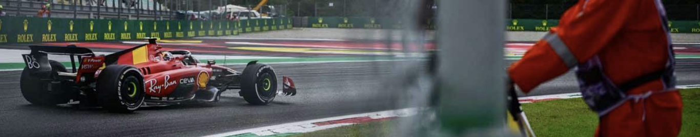

<p align="center">
  
</p>

# Braking analysis from Formula 1 telemetry, Monza 2023

Takes the speed trace of a qualifying lap, differentiates it, and reads off where a driver starts
braking for Turn 1 and how hard. The comparison is Verstappen against Sainz in the 2023 Italian Grand
Prix qualifying session, and the output is a braking profile laid out against distance along the
track rather than against time, so two laps run at different speeds still line up at the same point
on the circuit.

The calculation is checked against cases with known answers before it is pointed at real data. Given
a trace built to decelerate at -2.831578 G it returns -2.831578 G, and a test across sampling rates
shows that peak deceleration survives coarse sampling while the braking point does not: at 100
milliseconds between samples the braking point lands 8.9 metres late. Numbers below.


## How it works

**Getting the data.** `pipeline.py` pulls speed, throttle, brake and distance channels for the fastest
qualifying lap of each driver through the FastF1 library, which wraps the published timing feed.

**The maths.** Speed arrives in km/h and is converted to m/s. Longitudinal acceleration is the
derivative of speed with respect to time, computed with `numpy.gradient`, which uses a central
difference and is therefore second-order accurate on evenly spaced samples. Dividing by 9.81 puts the
result in G, which is how the figure is labelled because that is the unit the sport uses.

No smoothing is applied before differentiating. Smoothing first would shift the braking point, since
any filter with a window wider than a sample drags a sharp edge later in time, and the braking point
is exactly the sharp edge being measured. The dashboard applies a five-sample average for display
only, after the derivative has been taken.

**Picking the zone.** The braking zone is cut out by distance, from 600 to 1050 metres past the start
line, rather than by time. Two drivers reach Turn 1 at different moments, so a time window would
compare different parts of the corner; a distance window compares the same stretch of tarmac.

## Checking the maths

`verify_math.py` runs the pipeline on traces whose answer is known in advance, so the calculation can
be checked without any telemetry at all.

Feed it a speed ramp from 300 to 100 km/h over exactly two seconds, which is a deceleration of
-2.831578 G by hand, and it returns -2.831578 G, with the largest error anywhere in the trace being
4.7e-07 G. That is the expected result rather than a lucky one: a central difference is exact on a
straight line, so anything beyond rounding error would mean a bug.

The second check is the one that matters for reading a braking point off this data. Take a car
holding 340 km/h that brakes at exactly 780 metres, sample it at different rates, and ask where the
pipeline thinks the braking began:

| gap between samples | braking point found at | error |
|---|---|---|
| 1 ms | 780.0 m | 0.0 m |
| 10 ms | 780.4 m | +0.4 m |
| 20 ms | 781.3 m | +1.3 m |
| 50 ms | 784.2 m | +4.2 m |
| 100 ms | 788.9 m | +8.9 m |
| 240 ms | 781.3 m | +1.3 m |

Peak deceleration comes back as -5.00 G at every one of those rates, so the magnitude survives coarse
sampling. The braking point does not, and the error is not a tidy function of the gap: the 240 ms row
lands closer than the 100 ms row because what decides the answer is where the first sample after the
driver hits the brakes happens to fall. The gap sets a ceiling on the error, not a fixed value. At
340 km/h a car covers 0.9 metres between samples 10 ms apart and 22.7 metres between samples 240 ms
apart, and that distance is the honest resolution limit on any braking point quoted from this feed.

Which is why the next section exists.

## Checking the data before trusting it

`measure_telemetry.py` exists to answer the questions that have to come before any result: how often a
speed sample actually arrives, what the gap between samples is at the fifth and ninety-fifth
percentile, and how far apart the braking onset computed from the derivative sits from the car's own
brake channel, measured in samples, milliseconds and metres.

Run it before quoting any number from this repository:

```bash
pip install -r requirements.txt
python measure_telemetry.py
```

It prints the sampling interval it measured rather than relying on any assumed figure, which matters:
the published feed is far coarser than a car's internal sensors, and the resolution of the braking
point can be no finer than the gap between two samples. The figures above were produced by an earlier
run of the pipeline; `measure_telemetry.py` regenerates the underlying numbers from scratch.

## Running the rest

Static figures:

```bash
python generate_plots.py
```

Interactive dashboard:

```bash
streamlit run dashboard.py
```

First run downloads the session from the timing servers and caches it locally.

## Limits

- Deceleration here is kinematic, worked out from how the speed changes. It is not a measurement of
  force at the tyre, and it folds in aerodynamic drag, engine braking and the brakes themselves
  without separating them.
- Two laps, two drivers, one corner. Nothing here says anything general about either car.
- The resolution of the braking point is bounded by the sampling interval of the published feed, which
  is why the script above measures that interval rather than assuming it.
- Speed is scalar. Lateral acceleration through the corner is not part of this.

## References

1. Milliken, W. F. & Milliken, D. L. (1995). *Race Car Vehicle Dynamics*. SAE International.
2. FastF1: [theOehrly/Fast-F1](https://github.com/theOehrly/Fast-F1).

## License

[MIT](LICENSE)
